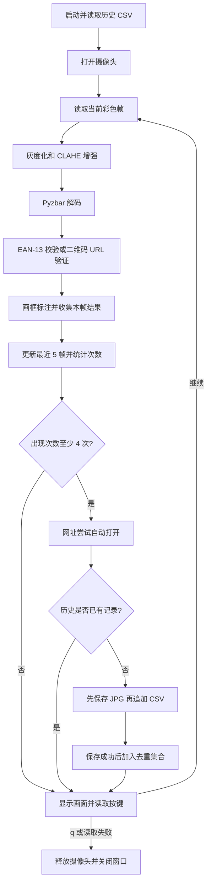

# 实时二维码与条形码识别系统：从零复刻手册

本文以当前工作区的 `src/` 模块化代码为准，介绍如何从空目录搭建、理解并验证项目。它描述的是推荐的复刻顺序，不代表项目真实开发历史。

原 README 部分内容对应旧版。复刻当前版本时，入口、二维码处理方式和去重机制请以本文和源码为准。

## 1. 最终要做出什么

这是一个运行在本地桌面上的 Python 程序。它通过摄像头获取画面，识别二维码和条形码，将通过验证的结果画在窗口中；同一个结果在最近 5 帧中至少出现 4 次后，保存一张现场图片和一条 CSV 记录。

当前版本的具体行为：

| 项目 | 行为 |
| --- | --- |
| 摄像头 | 默认使用编号 `0` |
| 二维码 | 只接受包含有效 HTTP/HTTPS 网址的二维码，普通文本二维码会被跳过 |
| EAN-13 | 必须通过长度、数字格式和校验位检查 |
| 其他可解码条码 | 保留 Pyzbar 返回的结果，没有额外业务校验 |
| 稳定确认 | 最近最多 5 帧中至少 4 帧出现相同的“类型＋原始内容” |
| 网址 | 达到确认条件后自动请求默认浏览器打开；同一次运行中同一网址只尝试一次 |
| 去重 | 启动时读取历史 CSV，同类型、同内容不重复保存 |
| 保存 | JPG 全画面截图＋CSV 文本记录 |
| 退出 | 在 OpenCV 窗口获得焦点时按 `q` |

**当前版本没有按 `o` 打开网址的操作，也没有训练模型、下载权重、搭建数据库、编译前端或部署服务器的步骤。** 条码解码能力来自 ZBar，Pyzbar 是其 Python 接口，OpenCV 负责图像及摄像头操作。

## 2. 先理解整体架构



程序中的主要模块分工如下：

| 文件 | 职责 | 主要接口 |
| --- | --- | --- |
| `src/validators.py` | 校验数据是否符合业务规则 | `is_valid_ean13(code)`、`get_valid_url(data)` |
| `src/scanner.py` | 增强图像并调用解码库 | `scan_codes(img)` |
| `src/storage.py` | 读取历史记录、保存截图和 CSV | `load_seen_codes(path)`、`save_record(...)` |
| `src/url_handler.py` | 调用默认浏览器 | `open_url(url)` |
| `src/main.py` | 串联摄像头、识别、统计、去重和界面 | `main()` |

## 3. 环境和材料准备

推荐先在带图形桌面的 Ubuntu 上复刻，再迁移到其他系统。需要可用的 Python、摄像头、桌面显示环境和默认浏览器。

依赖安装阶段需要网络；依赖安装完成后，摄像头识别和本地保存本身不需要联网，访问识别出的网页通常需要联网。

本工作区实际核查到的环境为：

| 组件 | 当前环境版本 |
| --- | --- |
| Python | 3.12.3 |
| opencv-python | 5.0.0.93，`cv2.__version__` 为 `5.0.0` |
| pyzbar | 0.1.9 |
| numpy | 2.5.4，由 OpenCV 的依赖关系安装 |
| OpenCV GUI | QT5 |

这些是当前环境的记录，不是项目声明的最低版本或完整兼容性矩阵。仓库的 `requirements.txt` 没有锁定版本；以后安装时可能得到不同版本。

### 3.1 Ubuntu 安装系统依赖

```bash
sudo apt update
sudo apt install python3 python3-venv python3-pip libzbar0
```

`libzbar0` 是关键：只执行 `pip install pyzbar` 并不代表 Linux 上的 ZBar 动态库已经安装。部分发行版会使用带 `t64` 后缀的包名，以发行版实际提供的包为准。

如果 OpenCV 导入时提示缺少 `libGL.so.1`，再安装：

```bash
sudo apt install libgl1
```

### 3.2 创建项目和虚拟环境

从空目录开始：

```bash
mkdir qr-code-recognition
cd qr-code-recognition
mkdir src
python3 -m venv .venv
source .venv/bin/activate
```

后续命令默认在这个项目根目录执行，并且已激活 `.venv`。

虚拟环境用于隔离项目依赖。离开当前环境可执行 `deactivate`；重新打开终端后，需要重新激活。

### 3.3 创建依赖文件并安装

新建 `requirements.txt`，内容与当前项目保持一致：

```text
opencv-python
pyzbar
```

执行：

```bash
python -m pip install -r requirements.txt
```

这里使用 `python -m pip`，可以减少 pip 与运行解释器不一致的问题。

本项目需要 `cv2.imshow()` 创建窗口，因此应安装 `opencv-python`。`opencv-python-headless` 主要用于无图形界面的场景，不能直接满足当前程序的窗口需求。

### 3.4 验证依赖

```bash
python --version
python -c "import sys; print(sys.executable)"
python -c "import cv2; print(cv2.__version__)"
python -c "from pyzbar.pyzbar import decode; print('Pyzbar / ZBar OK')"
```

验收标准：解释器指向项目虚拟环境，OpenCV 输出版本号，Pyzbar 成功导入。此时还没有验证摄像头和显示窗口。

### 3.5 Windows 与 macOS 的差异

Windows 可以用 `py -3 -m venv .venv` 创建环境，在 PowerShell 中用 `.\.venv\Scripts\Activate.ps1` 激活，在 CMD 中用 `.venv\Scripts\activate.bat` 激活。若不方便激活，也可直接用 `.\.venv\Scripts\python.exe` 执行安装和运行命令。

Windows 的 Pyzbar 安装包通常携带 ZBar DLL；若提示 DLL 加载失败，需要结合错误检查 Python 架构及缺失的运行库。Ubuntu 的 apt 命令不适用于 Windows。

macOS 通常先用 Homebrew 安装 `zbar`，再安装 Python 依赖，同时在系统隐私设置中授予终端或 IDE 摄像头权限。

本文实际完成的是当前 Linux 环境下的无摄像头功能验证，未逐个平台实测上述安装流程。

## 4. 建好最终目录

```text
qr-code-recognition/
├── .venv/                     # 本机创建，不复制给其他机器
├── requirements.txt
├── .gitignore
├── src/
│   ├── main.py                # 入口
│   ├── scanner.py             # 图像预处理与解码
│   ├── validators.py          # EAN-13 和 URL 校验
│   ├── storage.py             # 图片和 CSV 存储
│   └── url_handler.py         # 浏览器调用
├── pyzbar_images/             # 启动时自动创建
└── pyzbar_records.csv         # 首次成功记录时创建
```

最小 `.gitignore` 可写为：

```gitignore
.venv/
__pycache__/
*.py[cod]
pyzbar_records.csv
pyzbar_images/
```

当前程序使用相对路径，因此 CSV 和图片目录的位置由**启动命令所在的工作目录**决定，不是由脚本所在目录决定。统一在根目录运行 `python src/main.py`，才能让数据保存在上图位置。

## 5. 第一步：先确认摄像头能工作

在实现业务前，可以临时创建 `camera_check.py`：

```python
import cv2

cap = cv2.VideoCapture(0)
try:
    if not cap.isOpened():
        raise RuntimeError("无法打开摄像头")
    while True:
        ok, frame = cap.read()
        if not ok:
            raise RuntimeError("无法读取摄像头画面")
        cv2.imshow("Camera check", frame)
        if cv2.waitKey(1) & 0xFF == ord("q"):
            break
finally:
    cap.release()
    cv2.destroyAllWindows()
```

执行 `python camera_check.py`。应出现实时画面，窗口获得焦点后按 `q` 能退出。

`VideoCapture(0)` 的 `0` 是设备编号；多摄像头机器可能需要改为 `1`。`read()` 同时返回成功状态和图像，不能只处理图像而忽略读取失败。

这个脚本仅用于前置排错，不是最终项目必需模块。若此步失败，应先处理设备、权限或桌面显示问题。

## 6. 第二步：实现数据校验模块

创建 `src/validators.py`。完整源码见附录 A，这一步先理解两个函数的输入输出。

### 6.1 EAN-13 校验

输入为 13 位条码字符串，输出为布尔值。规则如下：

1. 检查长度是否为 13、内容是否为数字。
2. 取前 12 位，从左到右按人习惯的第 1、3、5……位乘 1，第 2、4、6……位乘 3。
3. 求加权和 `S`。
4. 计算校验位 `(10 - S % 10) % 10`。
5. 与第 13 位比较。

例如 `6901234567892`：奇数位置和为 `6+0+2+4+6+8=26`，偶数位置和为 `9+1+3+5+7+9=34`，加权和为 `26+3×34=128`，校验位为 `2`，因此通过。

注意：Python 列表下标从 0 开始，所以代码中的偶数下标对应人习惯的奇数位置。

校验位只能检查编码结构，不代表商品真实性，也不能据此查询商品名称。项目没有商品数据库。

### 6.2 URL 验证

`get_valid_url(data)` 先去除首尾空白，再使用 `urlparse()` 解析：

- 协议必须是 `http` 或 `https`。
- 必须有主机名。
- 去除首尾空白后的字符串内不能再有空白字符。

通过时返回处理后的网址，否则返回 `None`。

| 输入 | 结果 |
| --- | --- |
| `https://example.com` | 接受 |
| ` https://example.com ` | 去除首尾空白后接受 |
| `www.example.com` | 拒绝，缺少 HTTP/HTTPS 协议 |
| `hello world` | 拒绝 |
| `ftp://example.com` | 拒绝 |
| `https://example.com/a b` | 拒绝，内部含空格 |

这是格式筛选，没有执行域名可达性、网站信誉或完整 URL 合法性检查。

模块写好后，在根目录验证：

```bash
python -c "import sys; sys.path.insert(0, 'src'); from validators import is_valid_ean13, get_valid_url; assert is_valid_ean13('6901234567892'); assert not is_valid_ean13('6901234567893'); assert get_valid_url('hello') is None; assert get_valid_url('https://example.com') == 'https://example.com'; print('validators OK')"
```

## 7. 第三步：实现扫描模块

创建 `src/scanner.py`，核心链路为：

```python
gray = cv2.cvtColor(img, cv2.COLOR_BGR2GRAY)
clahe = cv2.createCLAHE(clipLimit=2.0, tileGridSize=(8, 8))
enhanced = clahe.apply(gray)
return decode(enhanced)
```

输入 `img` 是 OpenCV 摄像头得到的 BGR 彩色图像；先转为灰度图，再执行 CLAHE（限制对比度的自适应直方图均衡化），最后交给 Pyzbar 解码。

`clipLimit=2.0` 用于限制局部对比度增强强度；`tileGridSize=(8, 8)` 表示将图像按 8×8 个网格进行局部处理，并非每块只有 8×8 像素。

这种增强可能帮助部分低对比度图像，但不保证所有场景都更好；反光、失焦、运动模糊或条码尺寸过小仍会影响解码。

解码结果常用字段：

| 字段 | 含义 |
| --- | --- |
| `result.data` | 原始字节内容，需要解码成字符串 |
| `result.type` | 类型，例如 `QRCODE`、`EAN13` |
| `result.rect` | 外接矩形 `(x, y, w, h)` |

主程序使用 `decode('utf-8', errors='replace')` 处理字节。无法按 UTF-8 解码的字节会变成替代字符，因此项目并不完整支持任意编码的二维码内容。

## 8. 第四步：实现记录存储模块

创建 `src/storage.py`，包含三个函数。

### 8.1 `load_seen_codes(path)`：启动时加载历史

文件不存在时返回空集合；文件存在时，用 `csv.DictReader` 按中文字段名读取，将有效行转换成：

```python
{("QRCODE", "https://example.com"), ("EAN13", "6901234567892")}
```

这里使用 `(类型, 内容)` 二元组作为去重键。因此同样的字符串若类型不同，会视为不同条码。

历史 CSV 是跨重启去重的依据，图片文件是否存在不参与判断。已有记录时再次扫描，仍然可以显示识别框，但不会再次保存。

### 8.2 `cv2_imwrite(img, path)`：封装图片写入

内部调用 `cv2.imwrite()`，返回成功状态；捕获部分写入异常，避免直接把图片保存失败误判为整个记录已完成。

### 8.3 `save_record(...)`：先图片，后 CSV

执行顺序：创建图片目录 → 生成时间 → 保存 JPG → 打开 CSV → 必要时写表头 → 追加记录 → 返回 `True`。

图片名格式为 `年月日_时分秒_微秒.jpg`，例如 `20261022_140000_123456.jpg`。记录时间来自 `datetime.now()`，使用运行机器的本地时间；若手册要求北京时间，需要先确认系统时区。

CSV 字段如下：

```csv
识别时间,条码类型,识别内容
2026-10-22 14:00:00,EAN13,6901234567892
2026-10-22 14:00:03,QRCODE,https://example.com
```

使用 `encoding='utf-8-sig'` 有助于表格软件识别中文；`newline=''` 交给 CSV 模块处理换行；使用 `csv.writer` 可以正确转义内容中的逗号和引号。

需要理解保存边界：图片和 CSV 不是一个原子事务。图片写成功而 CSV 失败时，图片会保留，函数返回 `False`，后续可能再次尝试并产生额外图片。当前 CSV 没有图片路径字段，无法直接逐条关联截图。

## 9. 第五步：实现浏览器模块

创建 `src/url_handler.py`。调用 Python 标准库 `webbrowser.open(url)`，打印结果并返回布尔值，异常时返回 `False`。

它表示向浏览器发起打开请求，不能证明网页已经成功加载。

当前主程序是在打开之前就把 URL 加入 `opened_urls`，且没有利用 `open_url()` 的返回值更新状态。因此自动打开失败后，本轮运行不会对相同 URL 重试。

## 10. 第六步：编写主程序并串联模块

创建 `src/main.py`，完整源码见附录 E。推荐按下面顺序阅读或实现。

### 10.1 配置路径并初始化状态

```python
record_file = "pyzbar_records.csv"
image_dir = "pyzbar_images"
seen_codes = load_seen_codes(record_file)
recent_frames = deque(maxlen=5)
opened_urls = set()
```

| 变量 | 内容 | 生命周期 |
| --- | --- | --- |
| `seen_codes` | 已保存的 `(类型, 原始内容)` | 启动时从 CSV 恢复，运行中更新 |
| `recent_frames` | 最近最多 5 帧，每帧一个条码集合 | 只在当前进程中存在 |
| `opened_urls` | 本轮已尝试打开的规范化 URL | 只在当前进程中存在 |

当前代码把建目录、加载历史和这些变量初始化放在模块顶层，因此导入 `main` 本身就会产生这些操作。执行入口受 `if __name__ == '__main__'` 保护。

### 10.2 读取、过滤和标注当前帧

循环执行 `cap.read()`，读取失败则退出；调用 `scan_codes(img)`，对每个结果执行数据解码和分类验证。

当前逻辑是：EAN13 不合格则跳过；QRCODE 不是有效网址则跳过；其他类型继续处理。

验证通过后加入本帧集合 `frames_codes`，再用 `cv2.rectangle()` 画绿色框、`cv2.putText()` 画类型和内容。标签只显示前 50 个字符，CSV 中保存的是完整解码字符串。

原图用于绘制和保存，灰度增强图仅用于解码，因此 JPG 是带有已绘制标注的全画面，而不是条码裁剪图。OpenCV 内置字体对中文显示支持有限。

### 10.3 用滑动窗口进行多帧确认

每帧都执行：

```python
recent_frames.append(frames_codes)
```

未识别到任何合格结果时也加入空集合，才能让旧结果正常从窗口中退出。

之后遍历窗口内各帧的集合，统计每个条码出现了几帧。单帧用集合的意义是：即使一帧存在多个相同内容的码，也只贡献一次计数。

例如同一码的出现序列为：

| 帧 | 当前帧是否出现 | 当前窗口累计次数 | 是否满足确认 |
| --- | --- | --- | --- |
| 1 | 是 | 1 | 否 |
| 2 | 是 | 2 | 否 |
| 3 | 否 | 2 | 否 |
| 4 | 是 | 3 | 否 |
| 5 | 是 | 4 | 是 |

这个条件是“最近最多 5 帧中出现至少 4 次”，**并非必须连续 4 帧，也不需要等满 5 帧**。前 4 帧都识别到时，第 4 帧就可以确认。

它按帧计数，不是按秒计数。帧率改变，确认的实际时间也会改变。

另一个实现细节：程序处理的是整个历史窗口的计数，没有要求该码必须出现在当前帧。因此刚离开画面的码仍可能达到 4/5 条件，这时保存的是当前帧，截图中可能已经没有该码。

### 10.4 确认后先处理网址，再判断保存去重

逻辑顺序是：

1. 计数小于 4：跳过。
2. 如果是有效网址二维码，且本轮未打开过，则自动请求浏览器打开。
3. 如果 `(类型, 原始内容)` 已在 `seen_codes` 中：跳过保存。
4. 否则调用 `save_record()`。
5. 仅当返回 `True` 时，加入 `seen_codes`。

因此，历史中已保存的网址二维码在重启后重新达到确认条件时，**仍会再次触发浏览器打开，但不会再次写 CSV**。保存去重和网址去重是两套状态。

网址校验会去除首尾空白，但保存键使用原始 `data`；历史加载又会对内容执行 `.strip()`。一般网址没有影响，但首尾空白内容存在去重不一致的边界。

### 10.5 显示窗口并释放资源

`cv2.imshow()` 显示图像，`cv2.waitKey(1)` 让窗口处理界面事件并读取按键；检测到 `q` 后退出。

进入摄像头循环后，无论正常退出还是发生异常，`finally` 都执行 `cap.release()` 和 `cv2.destroyAllWindows()`。

当前代码的摄像头打开失败分支位于 `try` 之前，会打印“没有检测到摄像头”并直接返回；它不经过下面的 `finally`。若后续重构，可以统一资源管理范围。

## 11. 正式启动

确认所有文件已经按附录保存。在根目录执行：

```bash
source .venv/bin/activate
python src/main.py
```

不要使用旧 README 中的 `python test_pyzbar_code.py`，当前工作区没有这个文件。

当前模块使用 `from scanner import ...` 这样的同目录导入方式，直接执行 `python src/main.py` 是匹配当前代码的启动方法；不要未经修改就改成 `python -m src.main`。

启动后应先看到历史记录条数，再看到摄像头已打开的提示和实时窗口。拿一个二维码或 EAN-13 条码放在摄像头前，保证清晰、完整、光照均匀。当前版本会自动打开合格网址，联调时可使用内容为 `https://example.com` 的二维码。

## 12. 复刻验收清单

按下面顺序验收，有助于定位错误发生在哪一层。

| 操作 | 预期结果 |
| --- | --- |
| 导入 `cv2` 和 Pyzbar | 无动态库错误 |
| 运行摄像头检查脚本 | 有连续画面，按 `q` 退出 |
| 展示 `https://example.com` 二维码 | 出现框和标签；达到确认条件后请求打开浏览器 |
| 展示普通文本二维码 | 当前业务规则下跳过，不记录 |
| 展示真实可识别的 EAN-13 条码 | 通过校验、稳定确认后保存 |
| 首次保存新码 | 新增 CSV 行和 JPG 文件 |
| 本轮继续展示相同码 | 不重复保存；相同网址不再次尝试打开 |
| 退出后重新启动并展示旧码 | 加载历史；不重复保存；网址可能再次打开 |
| 展示新的合格码 | 可以继续追加记录 |
| 按 `q` | 画面关闭，摄像头释放 |

EAN-13 无效校验位的测试最好直接调用校验函数，因为底层解码库本身也可能拒绝不合格的条码图案。

测试跨重启去重时不要删除历史 CSV。需要演示首次识别时，可在新的测试目录中运行脚本，或先备份原有 CSV 和图片，避免混淆真实记录。

### 12.1 不用摄像头验证解码链路

将下面代码保存为根目录下的临时 `smoke_check.py`，用于检查扫描、保存及历史恢复。它不会导入主程序，也不会打开浏览器或摄像头；测试文件写入临时目录并在结束时清理。

```python
import sys
import tempfile
from pathlib import Path

import cv2

sys.path.insert(0, "src")
from scanner import scan_codes
from storage import load_seen_codes, save_record
from validators import get_valid_url, is_valid_ean13

assert is_valid_ean13("6901234567892")
assert not is_valid_ean13("6901234567893")
assert get_valid_url("hello") is None
assert get_valid_url(" https://example.com ") == "https://example.com"

# 使用 OpenCV 自带编码器生成测试二维码，不增加项目依赖。
qr = cv2.QRCodeEncoder_create().encode("https://example.com")
qr = cv2.resize(qr, None, fx=10, fy=10,
                interpolation=cv2.INTER_NEAREST)
img = cv2.cvtColor(qr, cv2.COLOR_GRAY2BGR)
results = scan_codes(img)
assert any(r.type == "QRCODE" and
           r.data == b"https://example.com" for r in results)

with tempfile.TemporaryDirectory() as temp:
    root = Path(temp)
    csv_path = root / "records.csv"
    assert load_seen_codes(csv_path) == set()
    assert save_record(img, "QRCODE", "https://example.com",
                       csv_path, root / "images")
    assert load_seen_codes(csv_path) == {
        ("QRCODE", "https://example.com")
    }
    assert len(list((root / "images").glob("*.jpg"))) == 1

print("无摄像头检查通过")
```

执行 `python smoke_check.py`。此检查需要 OpenCV 构建提供 `QRCodeEncoder_create()`；若旧版本没有该接口，可用已有二维码图片代替编码步骤。

整理本文时，已在当前虚拟环境中执行同等功能的检查：EAN-13、URL 验证、生成二维码的扫描解码、JPG/CSV 写入和历史重新加载均通过。此结果不覆盖真实摄像头、桌面窗口和默认浏览器联调。

## 13. 常见问题排查

| 现象 | 可能原因及处理 |
| --- | --- |
| `No module named cv2` 或 `pyzbar` | 检查虚拟环境和 `sys.executable`，用同一个 Python 安装依赖 |
| `Unable to find zbar shared library` | Linux 缺少系统 ZBar；安装发行版提供的 `libzbar0` 或对应包 |
| 缺少 `libGL.so.1` | Ubuntu 安装 `libgl1` |
| `imshow` 不支持或 GUI 错误 | 检查是否安装 headless 版本、是否有桌面显示环境；服务器无头运行需要改造界面逻辑 |
| 没有检测到摄像头 | 检查设备连接、摄像头编号、权限，关闭占用设备的其他程序 |
| 有画面但不识别 | 调整距离、清晰度、光照，确保码和周围留白完整；确认不是被业务规则过滤的文本二维码 |
| 有框但没有新增 CSV | 尚未达到 4/5 阈值，或历史记录已存在，或保存失败；检查终端输出 |
| 保存位置不对 | 运行时工作目录不同；从项目根目录启动 |
| CSV 中文乱码 | 使用支持 UTF-8 BOM 的方式打开，确认文件未被其他程序改写编码 |
| CSV 的数字末尾变化或前导零消失 | 表格软件自动当数字处理；按文本列导入，检查原始 CSV 内容 |
| 图片保存成功但无 CSV 行 | 检查 CSV 权限、文件占用及异常输出；当前两步写入不具备事务性 |
| 自动打开网址失败且不重试 | 检查默认浏览器；当前 `opened_urls` 在调用前更新，同轮不会重试 |
| 按 `q` 没反应 | 点击画面窗口使其获得焦点，切换英文输入后重试 |
| 中文标签显示异常 | `cv2.putText` 内置字体限制；可在后续扩展中用 Pillow 绘制中文 |

Linux 可用 `ls /dev/video*` 查看候选视频设备，但存在设备节点并不保证当前用户有权限或设备一定支持视频采集。

## 14. 如何打包成可复刻的项目材料

交付时应包含 `src/`、`requirements.txt`、说明文档和必要的示例素材。不要把本机 `.venv` 直接复制给其他机器，它包含与路径及平台相关的环境文件。

当前工作区的 Git 状态显示根目录旧 `main.py` 已删除、`src/` 尚未跟踪。因此仅克隆远程仓库，不能据此保证得到本文描述的模块化版本；发布复刻材料时应核对 5 个源码文件是否都已纳入交付。

需要增强同平台依赖复现能力时，可在已验收环境中额外执行：

```bash
python -m pip freeze > requirements-lock.txt
```

他人可使用 `python -m pip install -r requirements-lock.txt` 安装。锁定文件不替代 Python 版本、系统 ZBar、显示环境及摄像头说明；跨平台仍应重新验证。

建议记录操作系统版本、Python 版本、依赖版本、系统库安装命令、启动命令、测试条码及验收结果。首次交付前，应在新目录或新虚拟环境中按手册再跑一遍。

## 15. 当前实现的边界和可选改进

以下属于后续开发，不是复刻当前版本的前置步骤：

1. 把摄像头编号、目录、窗口长度和确认阈值提取到配置文件。
2. 要求当前帧仍存在该码，避免保存已经离场的条码对应的空画面。
3. 将图片路径写入 CSV，或使用 SQLite 关联记录与图片。
4. 统一原始内容与规范化内容的去重策略。
5. 浏览器打开成功后再记录状态，或者提供重试和手动打开操作。
6. 用临时文件、补偿或事务设计改善图片与日志的一致性。
7. 将顶层初始化移入入口，便于重复调用和独立测试。
8. 为纯文本二维码、中文标注、图像离线识别增加明确的业务分支。

## 16. 推荐的复刻顺序回顾

先准备系统库和虚拟环境，确认 Python 依赖能导入；再单独跑通摄像头；接着依次编写校验、扫描、存储、浏览器模块；最后在主程序中接上循环、多帧确认和去重，完成真实摄像头验收。

下面附上当前版本完整源码，可直接按文件名保存。附录是编写本文时的源码快照；后续修改实现时应同步更新。


## 附录 A：`src/validators.py` 完整源码

```python
# validators.py

from urllib.parse import urlparse
'''
检验EAN-13码是否有效，检验URL是否有效
'''

def is_valid_ean13(code):
    if len(code) != 13 or not code.isdigit():
        return False

    digits = [int(c) for c in code]

    total = sum(
        digits[i] for i in range(12)
        if i % 2 == 0
    )

    total += 3 * sum(
        digits[i] for i in range(12)
        if i % 2 == 1
    )

    check_digit = (10 - total % 10) % 10

    return check_digit == digits[12]


def get_valid_url(data):
    try:
        data = data.strip()
        parsed = urlparse(data)

        if (
            parsed.scheme in ("http", "https")
            and parsed.hostname
            and not any(c.isspace() for c in data)
        ):
            return data

    except ValueError:
        pass

    return None
```


## 附录 B：`src/scanner.py` 完整源码

```python
# scanner.py

import cv2
from pyzbar.pyzbar import decode
'''
    扫描二维码
'''


def scan_codes(img):
    gray = cv2.cvtColor(
        img, cv2.COLOR_BGR2GRAY
    )

    clahe = cv2.createCLAHE(
        clipLimit=2.0,
        tileGridSize=(8, 8)
    )

    enhanced = clahe.apply(gray)

    return decode(enhanced)
```


## 附录 C：`src/storage.py` 完整源码

```python

import os
import csv
from datetime import datetime


def load_seen_codes(path):
    """读取 CSV 中历史记录过的条码。"""
    codes = set()

    if not os.path.exists(path):
        return codes

    try:
        with open(
            path, "r",
            newline="",
            encoding="utf-8-sig"
        ) as f:
            for row in csv.DictReader(f):
                code_type = (row.get("条码类型") or "").strip()
                data = (row.get("识别内容") or "").strip()

                if code_type and data:
                    codes.add((code_type, data))

    except (OSError, csv.Error) as e:
        print("读取历史记录失败：", e)

    return codes


def save_record(img, code_type, data, csv_path, image_dir):
    """保存识别图片并将识别结果写入 CSV。"""
    os.makedirs(image_dir, exist_ok=True)

    now = datetime.now()
    time_text = now.strftime("%Y-%m-%d %H:%M:%S")
    filename = now.strftime("%Y%m%d_%H%M%S_%f") + ".jpg"
    save_path = os.path.join(image_dir, filename)

    # 先保存图片
    image_saved = cv2_imwrite(img, save_path)

    if not image_saved:
        print("图片保存失败：", save_path)
        return False

    try:
        # 文件不存在或为空时，写入表头
        need_header = (
            not os.path.exists(csv_path)
            or os.path.getsize(csv_path) == 0
        )

        with open(
            csv_path, "a",
            newline="",
            encoding="utf-8-sig"
        ) as f:
            writer = csv.writer(f)

            if need_header:
                writer.writerow(["识别时间", "条码类型", "识别内容"])

            writer.writerow([time_text, code_type, data])

    except (OSError, csv.Error) as e:
        print("CSV 保存失败：", e)
        print("图片已保存，但记录可能未写入：", save_path)
        return False

    print("识别时间：", time_text)
    print("条码类型：", code_type)
    print("识别内容：", data)
    print("图片已保存：", save_path)
    print("识别记录已保存：", csv_path)

    return True


def cv2_imwrite(img, path):
    """单独封装图片保存，便于统一处理保存错误。"""
    try:
        import cv2
        return cv2.imwrite(path, img)
    except (OSError, cv2.error) as e:
        print("图片保存异常：", e)
        return False
```


## 附录 D：`src/url_handler.py` 完整源码

```python

import webbrowser


def open_url(url):
    """使用系统默认浏览器打开网址。"""
    try:
        success = webbrowser.open(url)

        if success:
            print("已请求打开网址：", url)
        else:
            print("浏览器未能打开网址：", url)

        return success

    except Exception as e:
        print("打开网址失败：", e)
        return False
```


## 附录 E：`src/main.py` 完整源码

```python

import cv2
import os
from collections import deque

from scanner import scan_codes
from validators import is_valid_ean13, get_valid_url
from storage import load_seen_codes, save_record
from url_handler import open_url


# ---------------------------
# 1. 配置文件路径
# ---------------------------

record_file = "pyzbar_records.csv"
image_dir = "pyzbar_images"

os.makedirs(image_dir, exist_ok=True)


# ---------------------------
# 2. 加载历史记录
# ---------------------------

seen_codes = load_seen_codes(record_file)

print(f"已加载 {len(seen_codes)} 条历史条码记录")


# ---------------------------
# 3. 初始化多帧统计
# ---------------------------

recent_frames = deque(maxlen=5)

# 当前程序运行期间，已经打开过的网址
opened_urls = set()


def main():
    # ---------------------------
    # 4. 打开摄像头
    # ---------------------------

    cap = cv2.VideoCapture(0)

    if not cap.isOpened():
        print("没有检测到摄像头")
        return

    print("摄像头已打开，按 q 退出程序")

    try:
        while True:
            # ---------------------------
            # 5. 读取一帧画面
            # ---------------------------

            ret, img = cap.read()

            if not ret:
                print("无法获取摄像头画面")
                break

            # ---------------------------
            # 6. 调用识别模块
            # ---------------------------

            results = scan_codes(img)

            # 当前帧通过基本验证的条码集合
            frames_codes = set()

            # 当前帧识别到的有效网址
            frame_urls = set()

            for result in results:
                data = result.data.decode(
                    "utf-8",
                    errors="replace"
                )
                code_type = result.type

                # ---------------------------
                # 7. 验证识别结果
                # ---------------------------

                if code_type == "EAN13":
                    if not is_valid_ean13(data):
                        print("条码校验失败，忽略：", data)
                        continue

                elif code_type == "QRCODE":
                    url = get_valid_url(data)

                    # 本项目只接受包含有效网址的二维码
                    if url is None:
                        continue

                    frame_urls.add(url)

                # 其他条码类型暂时保留原有行为

                frames_codes.add((code_type, data))

                # ---------------------------
                # 8. 绘制识别框和文字
                # ---------------------------

                x, y, w, h = result.rect

                cv2.rectangle(
                    img,
                    (x, y),
                    (x + w, y + h),
                    (0, 255, 0),
                    3
                )

                label = f"{code_type}: {data}"

                cv2.putText(
                    img,
                    label[:50],
                    (x, max(y - 10, 25)),
                    cv2.FONT_HERSHEY_SIMPLEX,
                    0.6,
                    (0, 255, 0),
                    2
                )

            # ---------------------------
            # 9. 记录当前帧并统计最近 5 帧
            # ---------------------------

            # 即使当前帧没有识别到条码，也加入空集合
            recent_frames.append(frames_codes)

            code_counts = {}

            for frame in recent_frames:
                for code in frame:
                    code_counts[code] = (
                        code_counts.get(code, 0) + 1
                    )

            # ---------------------------
            # 10. 多帧确认、打开网址、保存记录
            # ---------------------------

            for code, count in code_counts.items():
                if count < 4:
                    continue

                code_type, data = code

                # 有效二维码达到多帧确认后，打开网址
                if code_type == "QRCODE":
                    url = get_valid_url(data)

                    if url and url not in opened_urls:
                        opened_urls.add(url)
                        open_url(url)

                # 历史记录中存在，就不重复保存
                if code in seen_codes:
                    continue

                # 保存图片和 CSV
                saved = save_record(
                    img,
                    code_type,
                    data,
                    record_file,
                    image_dir
                )

                # 只有完整保存成功，才标记为已处理
                if saved:
                    seen_codes.add(code)

            # ---------------------------
            # 11. 显示画面并检查退出按键
            # ---------------------------

            cv2.imshow("条码识别", img)

            key = cv2.waitKey(1) & 0xFF

            if key == ord("q"):
                break

    finally:
        # ---------------------------
        # 12. 释放资源
        # ---------------------------

        cap.release()
        cv2.destroyAllWindows()
        print("程序已退出")


if __name__ == "__main__":
    main()
```
